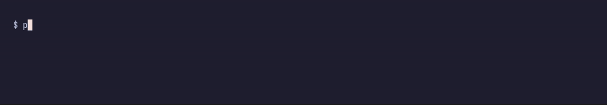

# claude-progressbar

Progress bars for the Bash commands Claude Code runs, drawn in its statusline.



While Claude runs a long command, Claude Code shows a spinner and a timer. claude-progressbar adds one bar per running command, foreground or background, and fills it from the best source it has:

- **Parsed** from the command's own output: the newest `42%`, `n/m` or `n of m` it printed.
- **Estimated** from earlier runs of the same command, when the output carries no progress. A run that outlasts its estimate is shown as overtime.
- **Animated** when neither is known, with the elapsed time and the command's last output line. A command that has printed nothing for 30 seconds is marked `quiet`.

## Install

```
/plugin marketplace add mvrozanti/claude-progressbar
/plugin install claude-progressbar@claude-progressbar
/claude-progressbar:setup
```

`/claude-progressbar:setup` points your `statusLine` at the plugin and keeps whatever you had there above the bars. To set it by hand, put this in `~/.claude/settings.json`:

```json
"statusLine": {
  "type": "command",
  "command": "sh -c 'exec python3 -S \"$(ls -d \"${CLAUDE_CONFIG_DIR:-$HOME/.claude}\"/plugins/cache/*/claude-progressbar/*/ | sort -V | tail -1)scripts/statusline.py\" --wrap claude-hud'",
  "refreshInterval": 1
}
```

`refreshInterval` is what keeps the bars moving: nothing else re-runs the statusline during a long tool call.

**Requirements:** Linux or WSL2 (it reads `/proc`), Python 3.9 or newer, and a Claude Code release whose `statusLine` supports `refreshInterval`.

## Styles

`--style NAME` picks the bar. [Watch all of them](media/tour.mp4).

| Style | What it draws |
|---|---|
| `rise` (default) | Braille cells that fill bottom-up over a dotted floor, eight steps per character. An estimate fills only the lower half; an unknown run is a rolling wave. |
| `field` | A twinkling dot field, denser and brighter toward the head, with a pill riding it. Two rows per command. |
| `dots` | Every dot of the grid visible, dim until lit. |
| `rail` | A solid fill riding a dotted rail. |
| `graph` | A braille chart of how much the command printed over its run. A stall shows as a flat line. |
| `digits` | The number first, in a fixed column, then a thin line. |
| `ruler` | Eighth-blocks with quarter ticks and one decimal. |
| `segments` | Twenty squares in groups of five. |
| `countdown` | Time left and the clock time the command should end. |
| `history` | This run drawn against the range and median of its past runs. |
| `today` | The original eighth-block bar. |

## Options

| Flag | Default | Meaning |
|---|---|---|
| `--style NAME` | `rise` | The bar style. |
| `--max-rows N` | `3` | Bars shown at once. The rest fold into one `+N more` line, youngest first. |
| `--wrap CMD` | none | A statusline to draw above the bars. `claude-hud` finds and runs the installed claude-hud. |
| `--palette FILE` | none | A kitty colour file. The `field` style takes its accent from `color12` and its track from `background`. |

## How it works

Every command Claude runs is a shell started by the `claude` process, with its output going to a task file. On each refresh claude-progressbar lists that process's children in `/proc`, keeps the ones writing to a task file, and reads the tail of each file.

When a command finishes, its duration is appended to `~/.local/state/claude-progressbar/history.jsonl`, keyed by the command with leading `cd …`, variable assignments and wrappers such as `sudo`, `timeout` and `rtk` stripped. The estimate is the median of the last seven runs. A command never seen before borrows from commands that start the same way, such as `nix build`, but only when those runs agree within a factor of three. In a chain such as `setup && main`, the last command decides which commands it borrows from.

The plugin also ships a skill. It tells Claude to keep progress visible on long commands: let output flow instead of piping it into `tail`, use flags such as `rsync --info=progress2`, and print `n/m` in its own loops.

## Cost

Each refresh is a Python process using about 20 ms of CPU, once a second, in every open Claude Code session.

## Known limits

- **Linux only.** macOS has no `/proc`. On macOS the statusline shows no bars, and nothing breaks.
- **Labels depend on Claude Code's shell wrapper.** The command is read from the `eval '…'` inside the shell Claude Code starts. If that wrapper changes shape, a label shows the whole wrapper instead.
- **An estimate cannot tell slow from stuck.** It only measures time against earlier runs. So once a command has printed nothing for 30 seconds, the percentage is replaced by `?` and the estimated fill dims, while the elapsed time against the usual duration stays.
- **Parsing is greedy.** Any percentage or `n/m` in the newest output lines counts as progress, so a log line such as `CPU 100%` or a date such as `10/12` can be misread.
- **`field` animates once a second.** The statusline refreshes at most once a second, so the twinkle steps instead of shimmering.

## Development

```
python -m unittest discover -s tests
python3 scripts/demo.py --tour
vhs media/tour.tape
```

`tests/goldens.json` pins the exact bytes every style draws for a fixed set of inputs, so a refactor that changes a single character fails. After an intentional visual change, run `python3 tests/update_goldens.py` and review the diff.

## License

MIT
